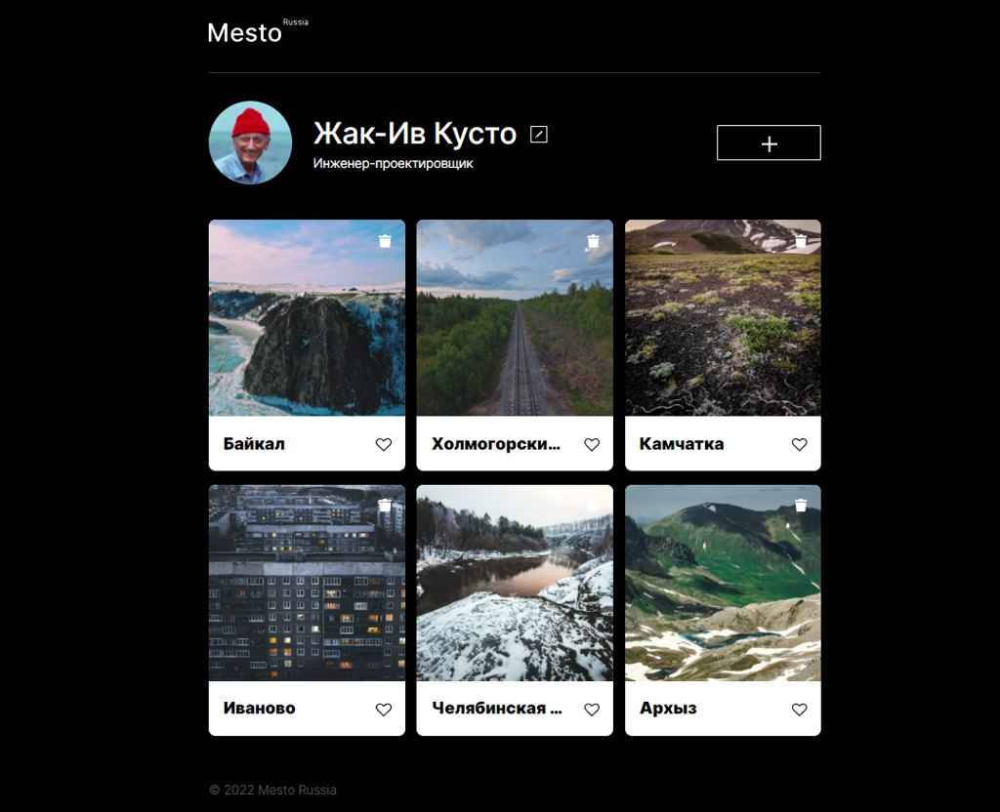
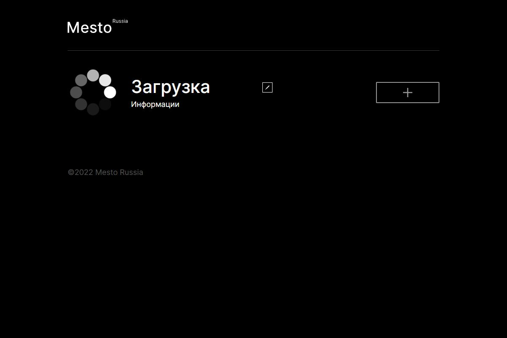

<div align="center">

# 🗺️ Mesto · фотокарточки на JavaScript

**Первая версия Mesto. Лента мест, профиль путешественника и формы редактирования собраны из классов и DOM-компонентов.**

  

[Открыть страницу](https://goldlexx.github.io/mesto/) · [Полная версия с аккаунтами](https://goldlexx.github.io/react-mesto-api-full/)

</div>



*Архивное изображение интерфейса из [портфолио автора](https://github.com/goldlexx/card-website/blob/main/images/projects/mesto.png). Наполнение опубликованной ленты зависит от доступа к API.*

## Что реализовано

Профиль объединяет имя, описание и аватар. Фотокарточка открывается крупно, поддерживает лайки и удаление своей публикации с подтверждением. Новое место задаётся названием и ссылкой на изображение. Для форм предусмотрена клиентская валидация, для диалогов — закрытие клавишей Escape.

[Точка входа](src/pages/index.js) запрашивает профиль и карточки совместно. За вставку элементов в DOM, поведение карточек, формы и работу с API отвечают отдельные [классы](src/components/). Структура [CSS-блоков](src/blocks/) следует БЭМ.

## Данные и доступ

По умолчанию клиент обращается к историческому API когорты Практикума. В приложении нет самостоятельной регистрации и встроенных учётных данных. При открытии публичной страницы во время подготовки README загрузилась оболочка, а данные профиля и ленты не появились.



Для локальной разработки можно указать до сборки `MESTO_API_BASE_URL` с адресом своего совместимого API или серверного посредника. Учётные данные такого сервиса должны оставаться на сервере.

## Локальный запуск

```sh
npm ci
npm run dev
```

Webpack Dev Server выведет локальный адрес. `npm run build` создаёт статическую сборку. При подключённом API можно проверить создание карточки, увеличение изображения и обновление счётчика лайков.

В манифесте проекта указана лицензия ISC. [package.json](package.json)
